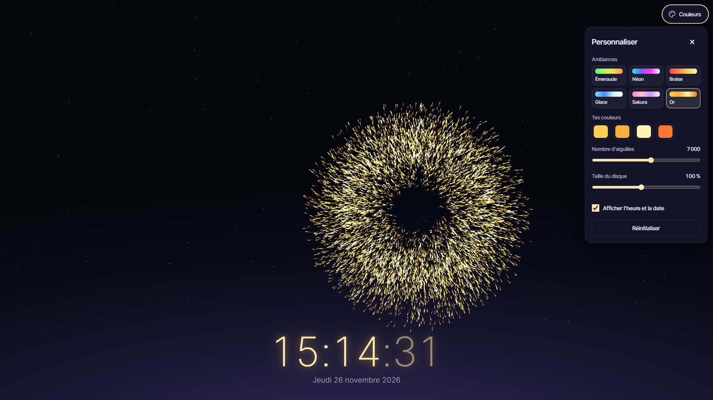

# ✦ Essaim lumineux

A swarm of **thousands of glowing needles** that follows your cursor across a night sky, with the time and date at the bottom of the screen.
When you move, the swarm chases you in a long wave; when you stop, it settles into a disc spinning around the cursor.




**Live demo:** https://ukiyoaj.github.io/essaim-lumineux/

## Features

- Up to **12,000 smooth particles**, rendered with **WebGL** (no library)
- The swarm **follows the mouse** on desktop and **your finger** on mobile
- **Click / tap**: the swarm bursts, then re-forms
- **Double-click**: full screen
- **Clock** and date at the bottom of the screen
- **"Couleurs" (Colors) panel**:
  - 6 ready-made themes: Émeraude, Néon, Braise, Glace, Sakura, Or
  - 4 fully customizable colors
  - adjustable needle count and disc size
  - show or hide the clock
  - your settings are saved in the browser (`localStorage`)

> The interface is in French. All the text lives in `index.html` and `js/essaim.js` if you want to translate it.

## Usage

Nothing to install: it's plain HTML, CSS and JavaScript.

```bash
git clone https://github.com/ukiyoaj/essaim-lumineux.git
cd essaim-lumineux
```

Then open `index.html` in your browser (double-click the file).

## Project structure

```
essaim-lumineux/
├── index.html      # the page: canvas, clock, settings panel
├── css/
│   └── style.css   # styles (sky, clock, panel)
├── js/
│   └── essaim.js   # simulation and WebGL rendering
├── apercu.png      # screenshot: Émeraude theme
├── apercu2.png     # screenshot: Colors panel, Or theme
├── LICENSE
└── README.md
```

## Customizing the code

Everything is at the top of `js/essaim.js`:

| What you want to change | Where |
|---|---|
| Add a color theme | `AMBIANCES` array |
| Share of each color in the swarm | `POIDS` array |
| Default number of particles | `DEFAUT.nombre` |
| Show the clock by default | `DEFAUT.horloge` |

The background (night gradient) and the clock are styled in `css/style.css`.

## How it works

1. Each needle is a small **damped spring** pulled toward a target point around the cursor.
   Every needle has its own stiffness: the slower ones lag behind, which creates the wave.
2. At rest, the target points are spread over a **spinning disc**, and the needles turn to point outward.
3. On every frame, the script computes the positions and builds **two triangles per needle**:
   a transparent tail and a bright tip. Everything is sent to the GPU in a single WebGL draw call,
   with **additive blending**, which creates the glow.
4. The followed point glides smoothly toward the mouse, and the physics runs in small sub-steps,
   so the animation stays smooth even if the browser slows down.

## Deploy with GitHub Pages

1. Push the repository to GitHub.
2. Go to **Settings → Pages**.
3. Under *Source*, pick the `main` branch and the `/ (root)` folder, then save.
4. After a minute, the site is live at `https://<your-username>.github.io/essaim-lumineux/`.

## Compatibility

Recent Chrome, Edge, Firefox and Safari, on desktop and mobile. WebGL must be enabled.

## License

[MIT](LICENSE) © 2026 Amine Jebali ([@ukiyoaj](https://github.com/ukiyoaj)). You're free to use, modify and share it, as long as you keep the license notice.
