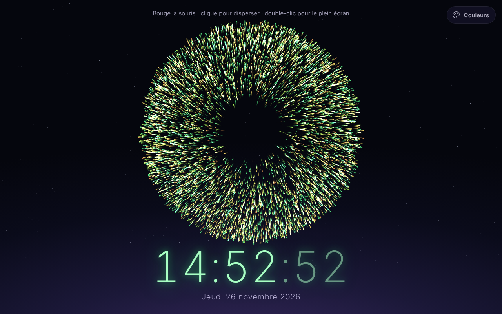

# ✦ Essaim lumineux

Un essaim de **milliers d'aiguilles de lumière** qui suit ton curseur sur un ciel de nuit, avec l'heure et la date en bas de l'écran.
Quand tu bouges, l'essaim te poursuit en une longue vague ; quand tu t'arrêtes, il se range en un disque qui tourne autour du curseur.




**Démo en ligne :** https://ukiyoaj.github.io/essaim-lumineux/

## Fonctionnalités

- Jusqu'à **12 000 particules** fluides, dessinées avec **WebGL** (aucune bibliothèque)
- L'essaim **suit la souris** sur ordinateur et **le doigt** sur téléphone
- **Clic / toucher** : l'essaim explose puis se reforme
- **Double-clic** : plein écran
- **Horloge** et date en français, en bas de l'écran
- **Panneau « Couleurs »** :
  - 6 ambiances prêtes : Émeraude, Néon, Braise, Glace, Sakura, Or
  - 4 couleurs entièrement personnalisables
  - nombre d'aiguilles et taille du disque réglables
  - horloge affichable ou masquable
  - tes réglages sont gardés dans le navigateur (`localStorage`)

## Utilisation

Aucune installation : c'est du HTML, du CSS et du JavaScript pur.

```bash
git clone https://github.com/ukiyoaj/essaim-lumineux.git
cd essaim-lumineux
```

Puis ouvre `index.html` dans ton navigateur (double-clic sur le fichier).

## Structure

```
essaim-lumineux/
├── index.html      # la page : canvas, horloge, panneau de réglages
├── css/
│   └── style.css   # le style (ciel, horloge, panneau)
├── js/
│   └── essaim.js   # la simulation et le rendu WebGL
├── apercu.png      # capture : ambiance Émeraude
├── apercu2.png     # capture : panneau Couleurs, ambiance Or
├── LICENSE
└── README.md
```

## Personnaliser dans le code

Tout se règle en haut de `js/essaim.js` :

| Ce que tu veux changer | Où |
|---|---|
| Ajouter une ambiance de couleurs | tableau `AMBIANCES` |
| Part de chaque couleur dans l'essaim | tableau `POIDS` |
| Nombre de particules par défaut | `DEFAUT.nombre` |
| Afficher l'horloge par défaut | `DEFAUT.horloge` |

Le fond (dégradé de nuit) et l'horloge se règlent dans `css/style.css`.

## Comment ça marche

1. Chaque aiguille est un petit **ressort amorti** attiré vers un point placé autour du curseur.
   Chaque aiguille a sa propre raideur : les plus lentes traînent derrière, ce qui crée la vague.
2. Au repos, les points cibles sont répartis sur un **disque qui tourne**, et les aiguilles s'orientent vers l'extérieur.
3. À chaque image, le script calcule les positions et construit **deux triangles par aiguille** :
   une queue transparente et une pointe claire. Le tout est envoyé à la carte graphique en un seul appel WebGL,
   en **mélange additif**, ce qui donne l'effet lumineux.
4. La position suivie glisse doucement vers la souris, et la physique est découpée en petits pas :
   l'animation reste fluide même si le navigateur ralentit.

## Mettre en ligne avec GitHub Pages

1. Pousse le dépôt sur GitHub.
2. Va dans **Settings → Pages**.
3. Dans *Source*, choisis la branche `main` et le dossier `/ (root)`, puis enregistre.
4. Au bout d'une minute, le site est en ligne sur `https://<ton-pseudo>.github.io/essaim-lumineux/`.

## Compatibilité

Chrome, Edge, Firefox et Safari récents, sur ordinateur et sur mobile. Il faut que WebGL soit activé.

## Licence

[MIT](LICENSE) © 2026 Amine Jebali ([@ukiyoaj](https://github.com/ukiyoaj)). Tu peux l'utiliser, le modifier et le partager librement, en gardant la mention de licence.
